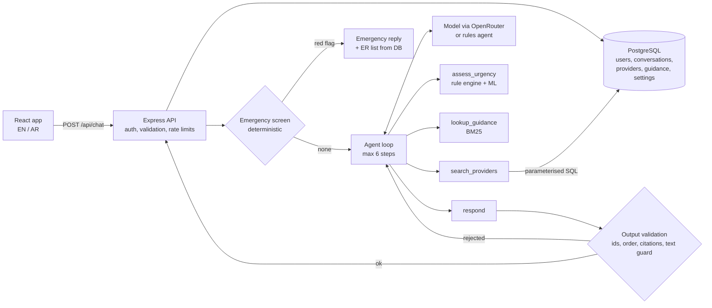

# Architecture and AI design

## Overview

The main design decision: **the language model handles language, code handles decisions.** The model reads messy patient text and phrases the reply. Emergency detection, urgency, department routing, which providers may be shown and what advice may be given are all decided or checked by deterministic code. A weak, free or failing model can therefore produce a clumsier answer, but not an unsafe or invented one.

## Request flow for one message

1. **Authentication and validation.** Only signed-in, active users reach the chat. The body is validated with zod (1 to 1000 characters, `lang` is `en` or `ar`, conversation id is a UUID owned by the user). Rate limit: 20 messages per minute per user, one reply at a time per conversation.
2. **Emergency screen** (`backend/src/triage/redFlags.ts`). Regular expressions over the patient's whole conversation, in English and Arabic, after normalisation: chest pain with arm/jaw pain or sweating, breathing difficulty, fainting, stroke signs, heavy bleeding, seizure, anaphylaxis, self-harm and more. A match returns a fixed emergency message and emergency departments from the database. The model is never called, so a model error or prompt injection cannot suppress an emergency.
3. **Agent loop** (`backend/src/agent/agent.ts`). The model calls tools; the backend runs them and returns the results until the model calls `respond` (maximum 6 steps).
4. **Validation** of `respond`, then the reply is saved with the conversation and returned. Provider cards are built from database rows by id, never from model text.
5. **Fallback.** If the model throws, times out, is rate-limited or ignores the tool protocol, the attempt is rolled back and the same turn is answered by the rules-based agent (`fallback_to_rules` in the trace).

## Tools

| Tool | Decided by | Purpose |
|---|---|---|
| `assess_urgency` | Rule engine (`triage/assess.ts`) and ML scorer | The model passes the facts the patient stated (symptoms, severity, onset, whether it is happening now). The engine returns `emergency`, `urgent` or `routine` with a department, or `needs_info` listing the missing facts. This is what makes the assistant ask clarifying questions: it cannot continue until the result is `ok`. |
| `lookup_guidance` | BM25 retrieval (`knowledge/retrieve.ts`) | Returns vetted bilingual guidance passages. Advice may only come from these, and the reply must cite their ids. |
| `search_providers` | Database query | Filters by department, city, language, insurance, emergency department and second-opinion availability. Only allowed after triage, and only for the recommended departments. |
| `respond` | Validator | Final message, next step, provider ids and guidance ids. |

Example rules: chest pain is never below `urgent`; ongoing chest pain with severity 7/10 or more is an emergency; any red flag is an emergency; a sudden severe headache is an emergency.

Example conversation: *"I have chest pain and I'm not sure whether to see a cardiologist, go to the ER or get a second opinion"* → the assistant asks about severity and timing → `assess_urgency` returns `urgent / cardiology` → `lookup_guidance` → `search_providers(cardiology)` → a recommendation with cardiologist cards. If the patient says it is 9/10 and happening now, the emergency response is returned instead.

## Preventing hallucinations

1. **Grounding by construction.** The model outputs provider ids; names, phone numbers and ratings are rendered from the database.
2. **Id allow-list.** `respond` may only use provider ids that `search_providers` returned in this conversation, and guidance ids that `lookup_guidance` returned.
3. **Required citations.** Recommendations must cite retrieved guidance; the UI shows the sources.
4. **Text guard** (`agent/guard.ts`). The reply text is scanned for provider or hospital names, "Dr. X" / "د. X" names and phone numbers that were not returned by a search. Violations are sent back to the model to fix.
5. **Order enforcement.** No recommendation without completed triage, guidance lookup and search. An empty search must be reported as "nothing found".
6. **Cross-checked facts.** Facts extracted by the model are compared with rule-based extraction from the patient's own words; the more cautious value wins, so a model cannot downgrade urgency.
7. **Least privilege.** Tool results sent to the model leave out phone numbers and ratings, so there is nothing to misquote.
8. **Bounded loop and safe fallback.** Step limit, timeout, rollback and a safe localized message with the emergency number.

These behaviours are covered by tests, including a scripted model that tries to invent a doctor and a phone number.

## Department scoring (ML / DL)

- 44 canonical bilingual symptoms (`backend/src/ml/symptoms.json`). The model extracts symptom ids; a rule-based extractor cross-checks them.
- Two models trained by `ml/train.py` (numpy + scikit-learn) and exported to `backend/src/ml/model.json`: `ml_linear` (multinomial logistic regression) and `dl_mlp` (one hidden layer). Inference runs in TypeScript; a test checks it matches the Python probabilities.
- The top departments gate `search_providers`, and provider cards show the match percentage. Emergencies are never routed by ML.
- Admins choose the engine (DL / ML / off), top-K, minimum score, and enable or rename departments.
- **The training data is synthetic**, sampled from a symptom/department probability table (`ml/knowledge.json`). The roughly 94% held-out accuracy measures how well the models learn that table, not clinical accuracy. For real use, replace `make_dataset` in `train.py` with clinician-labelled data and run `npm run train`.

## Knowledge retrieval

`knowledge/retrieve.ts` runs BM25 over a curated bilingual guidance set (emergency signs, chest pain, breathing, headache, fever, back and joint pain, abdominal pain, skin, second opinions, choosing a specialist). It is deterministic, free and auditable. Admins can edit the articles and the index is rebuilt immediately. At larger scale it can be replaced by embeddings (for example pgvector) and a reranker without changing the agent.

## Model providers and cost

| Tier | What runs | Cost | When |
|---|---|---|---|
| 0 | Rules-based agent: keyword extraction and bilingual reply templates, speaking the same tool protocol as a model | Free, offline | No key configured, or automatic fallback |
| 1 | Small or local model through any OpenAI-compatible endpoint (Ollama, Groq, LM Studio) | Free / low | Optional |
| 2 | Claude, GPT or Gemini through OpenRouter (or Anthropic directly) | Pay per use | Recommended |

With `OPENROUTER_API_KEY` set, the admin chooses the active model family and the exact OpenRouter model id, and can let patients pick a model. Defaults use OpenRouter's "latest" aliases so they do not go stale. Cost controls: token cap, 20-second timeout, cache for identical requests, per-user rate limit, 20 turns per conversation, short tool results.

## Bilingual support

- UI strings in `frontend/src/i18n.ts`; switching to Arabic sets `dir="rtl"` for the whole app; message text uses `dir="auto"`.
- The server detects the language of each message and replies in it, including emergency and fallback texts.
- Arabic normalisation before matching: diacritics and tatweel removed, alef/yaa/taa marbuta/hamza variants unified, Arabic-Indic digits converted (so `٨/١٠` is understood).
- Some Gulf dialect phrases are covered in the emergency screen (for example "مو قادر أتنفس").
- `backend/test/bilingual.test.ts` runs 12 cases in both languages and checks the same urgency, next step and department.

## Evaluation

`npm run eval` (also run in CI) reports emergency recall on 22 emergency phrases and false positives on 8 harmless ones (English and Arabic), decision accuracy on 12 cases in both languages, ungrounded or uncited replies, fallback rate and latency, plus an adversarial run with a model that invents a doctor. The command fails if emergency recall drops below 100% or an ungrounded reply gets through. The cases were written by the developer, so the scores show consistency, not clinical validity.

## Database (PostgreSQL)

PostgreSQL is the application database. Schema: [`db/migrations/001_init.sql`](../db/migrations/001_init.sql); setup, ER diagram and commands: [DATABASE.md](DATABASE.md).

| Table | Contents |
|---|---|
| `providers` | Doctors and hospitals (bilingual names, specialty, city, languages[], insurers[], ER, second opinions, rating, phone). Indexed by specialty/rating, city, and GIN indexes on the arrays |
| `guidance` | Vetted guidance passages the assistant cites |
| `users` | Google accounts, role, disabled flag, token version (for session revocation) |
| `conversations` | One row per chat: owner, title, server-only agent state (JSONB), version (optimistic locking) |
| `messages` | Chat messages; assistant rows keep the structured result (providers, sources, urgency) as JSONB |
| `app_settings` | Admin settings (model switch, instructions, ML, app), validated by the API before saving |
| `audit_log` | Admin and sign-in actions |
| `chat_events` | One row per answered turn, metadata only (never patient text); the admin statistics are SQL aggregates over it |
| `schema_migrations`, `app_meta` | Applied migrations and one-off markers (sample data seeded) |

How it is used:

- **Migrations** in `db/migrations/*.sql` are applied in order at start-up (or with `npm run db:migrate`), each in a transaction, guarded by an advisory lock so several instances can start at once.
- **Seeding** loads the 15 sample providers and the guidance passages once. A marker in `app_meta` makes sure providers deleted by an admin are not re-created on restart.
- **Provider search** (`search_providers`) is a parameterised SQL query: specialty, case-insensitive city, language and insurer (array membership), ER and second-opinion flags, ordered by rating, limited to 5.
- **Per-user isolation**: every conversation query filters by `user_id`; deleting a user cascades to their conversations and messages.
- **Concurrency**: saving a chat turn is one transaction that bumps `conversations.version` only if it still matches the version that was read, so two simultaneous turns cannot interleave even across server instances.
- **Settings and guidance** are also kept in memory for fast reads (the model router reads settings on every turn and the BM25 index is built from the guidance); every change is written to PostgreSQL first.
- **Health**: `/api/health` runs `SELECT 1` and returns 503 when the database is unreachable, so the host can restart or route around the instance.

The code reaches storage only through small interfaces (`backend/src/storage/types.ts`). Besides PostgreSQL there is a JSON-file implementation used for unit tests and for quick local experiments when `DATABASE_URL` is empty; production refuses to start without `DATABASE_URL`. The test suite runs against both, and CI runs it against a real PostgreSQL service.
